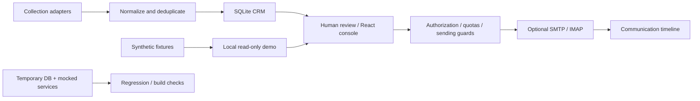

# ForeignTradeAssistant — Automation Engineering Showcase

面向 **AI 应用开发／自动化工程** 的项目展示：连接线索采集、规则分群、邮件工作流与 CRM 审核，用发送守卫、显式授权和回归测试控制业务副作用。

这是 AI 辅助开发的工程案例，重点是可复现的自动化系统和可靠的工程边界。代码保留可选的行业术语 LLM 翻译适配器；本地演示禁用模型调用，未用真实模型服务做验收，也没有 RAG 或模型训练成果。

## 一键体验：合成、只读、本地演示

演示生成 12 条虚构线索、标签、分组和沟通时间线。不加载 `.env`、不使用已有数据库、不启动采集或后台任务；API 写请求在业务处理前被拒绝，SMTP／IMAP 凭据被清空。

需要 Python 3.11+、Node.js 24 与 npm：

```bash
git clone https://github.com/Lucas-9999/ForeignTradeAssistant.git
cd ForeignTradeAssistant
python -m venv .venv
# Windows PowerShell: .\.venv\Scripts\Activate.ps1
# macOS / Linux: source .venv/bin/activate
pip install -r requirements.txt
npm --prefix frontend ci
npm --prefix frontend run build
python tools/run_portfolio_demo.py
```

打开 `http://127.0.0.1:8001/ui/`。修改、发送及提供商测试请求会收到只读提示。退出后清理本次演示自己生成的临时数据。也可只检查初始化：

```bash
python tools/run_portfolio_demo.py --inspect
```

## 可检查的工程能力

| 能力 | 实现入口 |
| --- | --- |
| 工作流与适配器分离 | `collector/`、`crm/`、`emailer/`、`engine/`：采集、去重、模板、回复识别与跟进 |
| 服务与可视化界面 | `api/`、`app.py`、`frontend/`：FastAPI、React、TypeScript、SQLite |
| 副作用控制 | `emailer/batch.py`、`services/`：发送守卫、配额、一次性授权与域名检查 |
| 可恢复的数据边界 | `crm/db.py`、`tools/backup_db.py`、`tools/migrate_db.py`：schema 门禁、快照与迁移 |
| 可重复验收 | `tests/`：临时数据库、模拟提供商、错误及授权路径 |
| 安全演示 | `tools/run_portfolio_demo.py`、`tests/test_portfolio_demo.py`：合成数据、loopback、只读请求边界 |



采集和邮件模块作为实现样例保留，演示关闭其外部行为；核心守卫、额度、一次性授权和 schema 保护保留。

## 验证

```bash
python -m pytest -q
npm --prefix frontend run lint
npm --prefix frontend run build
```

2026-10-12 展示代码实测：**640 项 Python 测试通过**，包含 9 项演示安全回归；测试不读取本机 `.env`，邮件测试显式使用虚构凭据和模拟连接。前端构建通过；独立仓库目录内 lint 实际扫描通过，0 错误、1 条既有 HMR 警告。这些是本地验证结果。

## 展示范围

- 独立项目快照和新的提交历史；排除了客户原件、真实环境、运行库、日志、浏览器会话、运营台账及业务 PDF。
- 身份、收件人与演示记录均为合成值；Gmail／Zoho 等公开提供商测试地址不代表真实账号。
- 已修补 `source-map-js` 的兼容安全更新；剩余构建依赖问题见 [依赖复核](docs/dependency-review.md)。
- 这是本地招聘展示，不提供公开生产服务，也不将模拟时间线计入真实发送成绩。
- 保留原版权及第三方依赖许可，没有擅自新增 MIT 等开放许可证。

项目取舍与面试讨论点见 [工程案例说明](docs/portfolio-case-study.md)。
